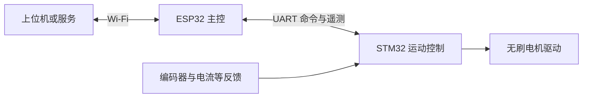

# 架构与模块边界

## 已确认硬件

- ESP32-C6 Mini：主控与 Wi-Fi。
- STM32G431C：运动控制，完整料号及封装待确认。
- 两个无刷电机，反馈器件选用 AS5600；编码器数量与接线待确认。
- 两端通过 UART 通信，波特率、引脚及电平待确认。

## 系统分工

ESP32 负责 Wi-Fi 连接、上层命令校验、命令调度、设备状态聚合以及向上位机报告故障。
STM32 负责运动状态机、控制周期、反馈采集、电机驱动和本地故障处理。控制环路不依赖 Wi-Fi 的实时性。

## 固件内部边界

摄像头调试模块独立采用 ESP32-P4 + IMX708，位于 `firmware/esp32/examples/imx708_usb/`，电脑预览与检测位于 `tools/camera_facetrack/`。USB 视频链路不属于 ESP32-C6 Mini / STM32 的运动命令协议，当前没有自动控制电机。ES8311 麦克风与喇叭作为同一 P4 固件的音频组件；电脑端 `voice_session.py` 调用独立 vi-agent 项目的原生语音入口，不在此仓库复制模型与对话实现。

`serial_video.py` 是 4 Mbaud UART 的唯一物理读写者，分流完整视频记录、麦克风数据和音频确认；`board_broker.py` 通过带临时凭据的本机 TCP 连接为 vi-agent 提供音频操作。语音不释放或重开摄像头串口，预览与人脸追踪持续运行；生成和播放回复时仅暂停麦克风以减少回声。v19 使用 400ms 软件播放缓冲及 200ms 预填充，音频期间将视频目标从 2.4Mbps / 28FPS 降为 1Mbps / 14FPS，目标帧率不等于实际显示帧率。`robot_console_server.py` 提供本机 HTTP 8791 状态、预览与控制，统一网页入口为 `http://127.0.0.1:5173`，模型服务仍为 8790。v19 已完成过人脸自动触发的并发回合。同一 Node 进程持续会话已实测多轮；本次第三轮的实际原因是 12 秒未检测到讲话而超时，期间收到 607 个麦克风包，序号缺口和传输错误均为 0，并非 bridge 断连。首因保留已修复；正在调整为安静时持续聆听、仅无音频包等异常才报错，尚待实机回归。会话端已延长 45 秒看门狗并接入心跳，相关 7 项回归通过。当前模型首音频约 6–13 秒，音质与流畅性尚未验收。仅明确的 `invalid_pcm` 负确认允许同一序号重发，最多 3 次发送尝试（首次加 2 次重试）；确认超时不重发，以免重复播放。`transport_stats` 保留最近 8 条音频控制错误元数据。没有新增自动烧录入口。详见 [摄像头技术说明](camera-imx708.md) / [English](camera-imx708.en.md)。

两端均按 application（业务状态机）、domain（平台无关逻辑）、drivers/adapters（硬件与 SDK 适配）拆分。

电脑端 `robot-console.ps1` 是统一生命周期入口，配置见 `robot-console.example.json`；私有配置、PID 身份及日志保存在被忽略的 `tools/camera_facetrack/runtime/robot-console/`。默认启动原生语音模型 8790、`app.py --headless` 设备服务 8791 与 Vite 网页 5173，可选 vi-agent 工作台 API 8787 默认关闭。网页将 `/api/robot` 代理到设备服务，其余 `/api` 保留给可选工作台；代理目标只接受本机 HTTP origin。摄像头后台不另开可见 Tk 窗口。默认 `VI_NATIVE_ONLY=true` 只挂载设备状态与真实回复，工作台、云语音、文字发送和 Key 设置不在该模式挂载。功能开关控制启动配置，faceVoice 必须依赖 camera；语音须经新鲜人脸稳定门控，人工聆听不能绕过。`continuous` 默认在同一 Node 进程逐轮恢复聆听，人脸离开 0.75 秒或画面过期 1 秒会在收音、生成、播放任一阶段取消；`single` 以 `--once` 执行一轮，完成后需离开再出现以重新触发。`runtime/view-settings.json` 持久化 `voice_mode`，HTTP `configure.mode` 仅接受这两个枚举。

默认端到端语音只使用本机 LLaMA-Omni2，不需要任何 API Key、额外文本模型或云 ASR/TTS；也不启动 Pi 后台任务。原生音频目前独立回答，尚未调用 Pi 工具或共享记忆。工作台是保留的显式可选模式，其依赖或模型目录错误不能阻塞默认原生语音启动；本地语音故障不回退云服务。

启动器对已有端口先做服务健康验证并复用，不接管已有进程；只按 PID、创建时间、可执行路径、完整命令与自有 runner 路径管理自己创建的进程树。启动等待有上限，必要服务失败只回收本次新增的自有进程；可选工作台失败单独告警。状态检查、日志查看、停止和重启共用该入口；Logs 仅展示有限的自有日志末尾，不读环境凭据文件。这些进程管理离线测试与真实设备并发验收分别记录。
只在确认硬件及构建系统后创建对应源码目录，避免空壳接口锁定实现。

STM32 工程生成代码单独管理，手写控制逻辑通过适配层调用，防止 CubeMX 重新生成覆盖业务逻辑。
具体采用的控制算法、控制频率、反馈模式及驱动方式需要依据电机、传感器和硬件能力确定。

## 双轴控制

两个电机分别维护目标、反馈、校准参数和故障状态，协议显式携带轴编号。
共享 UART 接收服务仅负责校验并提交命令，由运动状态机决定是否执行。
双轴目标如需同步生效，需定义批量目标及原子接受规则；尚未确定同步精度。
单轴故障是否联动停止另一轴，必须根据机器人的机械耦合与风险确定。

## 共享协议

`shared/protocol` 是消息语义、版本策略和测试向量的唯一来源。两端不得维护相互独立的协议定义。
UART 传输层负责分帧、收发及与物理接口相关的校验，协议层负责消息字段、单位、合法性及兼容性。

首批需定义的消息：握手与能力查询、心跳、使能/停机、运动目标、状态与故障、故障复位请求。
字段需显式定义字节序、长度、单位、取值范围和协议版本；不要直接发送 C 结构体内存。
命令应有序号和响应关联规则；重发、重复命令、陈旧目标和重启后会话的处理需在实现前约定。

## 运动保护

- STM32 上电默认禁止输出；只有配置和必要检查完成后才允许显式使能。
- 板间通信超时、传感器异常及驱动故障由 STM32 本地处理，不等待 ESP32 或网络确认。
- 心跳存活与运动目标新鲜度分别判断，避免心跳正常但旧目标持续执行。
- 超时后采用停止、减速还是关闭输出，以及阈值和制动行为，由机械负载和硬件验证决定。
- 故障恢复不得自动重新执行旧运动目标；重新使能需要明确状态与新命令。
- 硬件急停、过流与温度保护的实现方式需结合电路确认，软件命令不能替代硬件保护。

## 构建与版本

ESP32 与 STM32 各有自己的工具链、配置和依赖锁定方式。根目录工具仅负责编排，不混合底层构建。
一次集成版本需记录两端固件版本、协议版本和硬件版本，并验证兼容矩阵。
CI 后续分别执行协议主机测试、各端逻辑测试和目标固件编译；实机测试单独记录。
