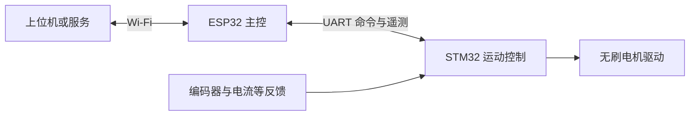

# 架构与模块边界

## 已确认硬件

- ESP32-C6 Mini：主控与 Wi-Fi。
- STM32G431C：运动控制，完整料号及封装待确认。
- 两个无刷电机，反馈器件选用 AS5600；编码器数量与接线待确认。
- 两端通过 UART 通信，波特率、引脚及电平待确认。

## 系统分工

ESP32 负责 Wi-Fi 连接、上层命令校验、命令调度、设备状态聚合以及向上位机报告故障。
STM32 负责运动状态机、控制周期、反馈采集、电机驱动和本地故障处理。控制环路不依赖 Wi-Fi 的实时性。

## 固件内部边界

摄像头调试模块独立采用 ESP32-P4 + IMX708，位于 `firmware/esp32/examples/imx708_usb/`，电脑预览与检测位于 `tools/camera_facetrack/`。USB 视频链路不属于 ESP32-C6 Mini / STM32 的运动命令协议，当前没有自动控制电机。后续喇叭验证也采用独立示例目录，不与摄像头共用构建输出或自动烧录入口。详见 [摄像头技术说明](camera-imx708.md) / [English](camera-imx708.en.md)。

两端均按 application（业务状态机）、domain（平台无关逻辑）、drivers/adapters（硬件与 SDK 适配）拆分。
只在确认硬件及构建系统后创建对应源码目录，避免空壳接口锁定实现。

STM32 工程生成代码单独管理，手写控制逻辑通过适配层调用，防止 CubeMX 重新生成覆盖业务逻辑。
具体采用的控制算法、控制频率、反馈模式及驱动方式需要依据电机、传感器和硬件能力确定。

## 双轴控制

两个电机分别维护目标、反馈、校准参数和故障状态，协议显式携带轴编号。
共享 UART 接收服务仅负责校验并提交命令，由运动状态机决定是否执行。
双轴目标如需同步生效，需定义批量目标及原子接受规则；尚未确定同步精度。
单轴故障是否联动停止另一轴，必须根据机器人的机械耦合与风险确定。

## 共享协议

`shared/protocol` 是消息语义、版本策略和测试向量的唯一来源。两端不得维护相互独立的协议定义。
UART 传输层负责分帧、收发及与物理接口相关的校验，协议层负责消息字段、单位、合法性及兼容性。

首批需定义的消息：握手与能力查询、心跳、使能/停机、运动目标、状态与故障、故障复位请求。
字段需显式定义字节序、长度、单位、取值范围和协议版本；不要直接发送 C 结构体内存。
命令应有序号和响应关联规则；重发、重复命令、陈旧目标和重启后会话的处理需在实现前约定。

## 运动保护

- STM32 上电默认禁止输出；只有配置和必要检查完成后才允许显式使能。
- 板间通信超时、传感器异常及驱动故障由 STM32 本地处理，不等待 ESP32 或网络确认。
- 心跳存活与运动目标新鲜度分别判断，避免心跳正常但旧目标持续执行。
- 超时后采用停止、减速还是关闭输出，以及阈值和制动行为，由机械负载和硬件验证决定。
- 故障恢复不得自动重新执行旧运动目标；重新使能需要明确状态与新命令。
- 硬件急停、过流与温度保护的实现方式需结合电路确认，软件命令不能替代硬件保护。

## 构建与版本

ESP32 与 STM32 各有自己的工具链、配置和依赖锁定方式。根目录工具仅负责编排，不混合底层构建。
一次集成版本需记录两端固件版本、协议版本和硬件版本，并验证兼容矩阵。
CI 后续分别执行协议主机测试、各端逻辑测试和目标固件编译；实机测试单独记录。
