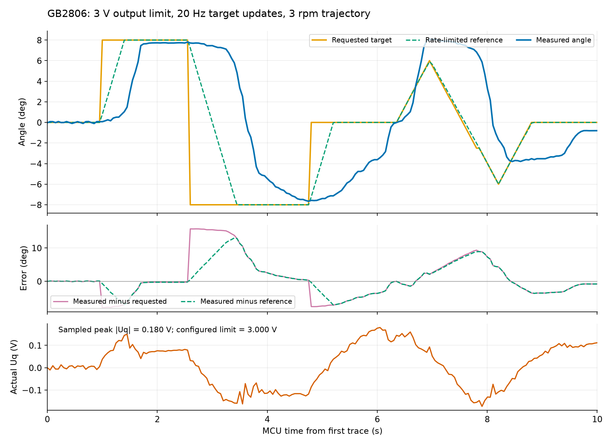

# 3V、20Hz 拖动端到端短测试

日期：2026-10-24。GB2806／DengFOCmini MP6536／STM32G431CBT6／AS5600 PWM，12V供电。

## 配置与方法

- Uq输出上限从1V提高到3V；校准电压仍1V，位置速度仍3rpm，速度PI仍P=0.08、I=1.0、D=0。
- 浏览器实时目标队列从200ms改为50ms，保持单请求在途、合并最新目标和独立运行心跳。
- 固件启用FOC_DEBUG_TRACE，20Hz记录MCU受理目标时间戳、目标command_id、实际角度、规划参考、实际Uq与限幅。发送缓冲不足时丢帧，不阻塞控制。
- 通过真实网页的启动按钮和现有滑块input/change事件，依次发送0→+8°、+8→−8°、−8→0°，随后按0.5°增量连续拖动0→+6→−6→0°并松手保持。页面请求经过HTTP后端、CH340串口、MCU闭环，再由AS5600反馈回串口。
- 使用ST-Link烧录校验；测试时未挂起CPU或设置断点。记录浏览器请求及ACK时刻，并独立轮询后端日志保存MCU原始TRACE。动作阶段约10秒，结束显式STOP。

固件SHA-256：`720ba4e4cc672b3a6c2805fcf595bdd4713eb1d41f3e870b3a63ffe5b20ac0d7`；Flash69784字节，RAM5080字节。六套C++测试、三组JS测试及固件构建通过。

## 实测结果

| 项目 | 结果 |
| --- | --- |
| 成功TARGET请求 | 52条，全部HTTP200、匹配MCU ACK，无失败 |
| 浏览器发出→MCU ACK经后端返回 | 中位10.9ms，P95 17.6ms，最大23.6ms |
| 连续输入→请求发出 | 中位0.2ms，最大0.5ms；本次输入未超过队列处理速率 |
| 连续目标请求间隔 | 中位51.8ms，约19.3Hz；最小50.6ms |
| MCU受理+8°→沿目标方向位移至少0.5° | 约394ms |
| MCU受理−8°→沿目标方向位移至少0.5° | 约644ms |
| MCU受理回0°→沿目标方向位移至少0.5° | 约493ms |
| 三个阶跃在下一目标前的末次误差 | −0.191°、+0.343°、−0.012° |
| 连续拖动时实际角度相对最新目标的RMSE | 4.94°，最大绝对误差9.34° |
| 目标更新后相对规划参考的RMSE | 4.72°（包含阶跃与往返） |
| 松手目标0°保持约1.2秒后的末次活动采样 | −0.800° |
| 实际Uq采样峰值 | 0.180V，上限3.000V，未观察到电压限幅 |
| 结束状态 | READY／STOP，EN关闭，fault=NONE，编码器有效 |

TRACE共200条，间隔中位50ms、最大100ms。位移响应的阈值为0.5°，用于排除编码器抖动；这不是首次微小位移的精确时间，50ms采样会引入约一帧的不确定性。HTTP耗时包含浏览器、后端、串口和ACK返回；浏览器与MCU没有同步时钟，因此不把二者的绝对时间直接相减。页面5Hz回显不作为机械响应时间依据。

本次未做相同工况的1V/3V A/B，不能量化提高上限带来的改善，也未做负载、相电流或热测试。步进目标的误差同时受18°/秒轨迹限制影响；连续拖动段的目标斜率约10°/秒，低于该速度限制，仍存在明显跟随滞后。

## 判断

本轮通信和目标下发已达到约20Hz，机械响应仍明显慢。实际输出采样峰值仅0.18V，未接近3V限幅，继续增加电压上限预计不会解决本轮滞后。先保留3V；下一步应针对速度环增益、积分响应、摩擦与换向动态调参，再检查速度／轨迹限制，避免把输出限幅与控制器实际输出混为一谈。

原始记录：[MCU TRACE](trace.csv)、[浏览器请求](requests.csv)。曲线时间以MCU首条TRACE为零；Uq图纵轴只展示本次实际输出范围，上限3V未画入该纵轴。
