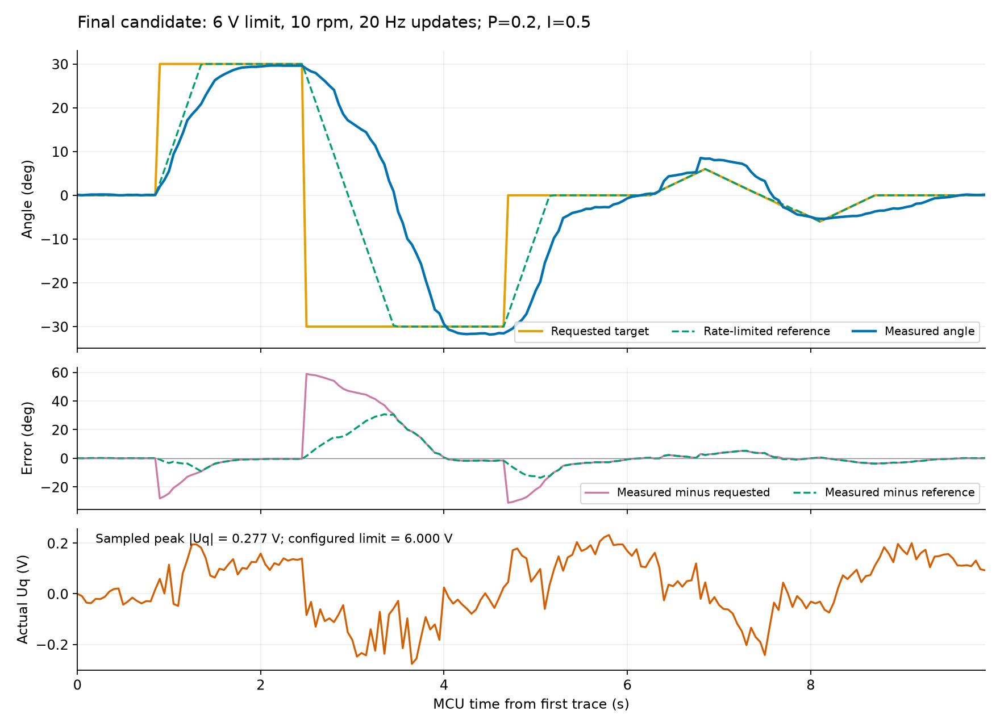

# 高速拖动调试与最终10rpm设置

日期：2026-10-24。硬件为12V GB2806／7极对、DengFOCmini MP6536、STM32G431CBT6、AS5600 PWM、ST-Link与CH340。

## 最终设置

| 参数 | 值 |
| --- | --- |
| 允许Uq上限／校准电压 | 6V／1V |
| 默认及允许的最高目标速度 | 10rpm＝60°/秒；最低0.1rpm |
| 速度PI／角度P | P=0.20、I=0.5、D=0；角度P=8 |
| 电压输出斜率／速度滤波 | 10V/s；2ms |
| 拖动队列／调试TRACE | 最多20Hz／20Hz，均保持单请求或有界非阻塞输出 |
| 保护 | 2rad/s超速保护开启、±90°软限位、编码器检查、通信租约及看门狗保留 |
| 固件SHA-256 | `6becb53f22e3fef41d1f0b2eeed2b640801b8169faed659570237bd6650162d2` |
| 固件资源 | Flash69800字节，RAM5080字节 |

电压上限是闭环可用幅值，实际Uq由控制器计算。10rpm是本轮保留的软件档位，不是GB2806物理极限，也没有验证长期满载或温升。

## 端到端方法

每次候选均通过ST-Link写入校验，在真实网页显式校准和启动。页面滑块input/change事件经现有队列、HTTP后端、CH340串口、MCU闭环控制，再由真实AS5600反馈。浏览器临时只读记录fetch请求／ACK时间，主机独立采集包含MCU时间戳和command_id的TRACE。

最终固件再次执行0→+30°→−30°→0°，再按0.5°增量连续拖动0→+6°→−6°→0°并松手保持，约10秒。连续拖动目标斜率约10°/秒。结束显式STOP并另行确认READY、EN低、run_id=0、fault=NONE。

## 最终固件复测

| 测量项 | 结果 |
| --- | --- |
| TARGET请求／MCU TRACE | 52条全部成功／199帧 |
| 浏览器发出→芯片ACK返回 | 中位10.75ms，P95 19.4ms |
| 连续请求间隔 | 中位51.6ms，约19.4Hz |
| MCU受理→沿目标方向位移≥0.5° | +30°为47ms，−30°为46ms，回0°为47ms |
| 三个阶跃在下一目标前的末次误差 | −0.387°、−1.559°、+0.378° |
| 阶跃最大超调 | 约1.815°，发生在负向目标 |
| 连续拖动相对最新目标RMSE／峰值误差 | 2.598°／5.226° |
| 松手0°保持后的末次活动误差 | +0.153° |
| 实际Uq采样峰值／速度采样峰值 | 0.277V／14.908rpm |
| 本轮结论 | 最终10rpm大角度往返与连续拖动复测通过，未触发故障；动态误差仍需进一步优化 |

上一轮3V、3rpm、较低增益的位移响应约394～644ms，连续拖动RMSE为4.94°。本轮同时修改增益、速度及电压上限，阶跃幅度也由±8°扩大到±30°，不能将改善归因于6V单一变量。实际Uq仍未接近6V限幅。

TRACE为50ms抽样，位移阈值0.5°用于排除读数抖动，约46～47ms不代表精确到1ms的首次运动时刻；采样峰值也不代表连续时间峰值。浏览器与MCU时钟未同步，HTTP耗时与MCU内运动时间分别计算，不把不同设备的绝对时间直接相减。页面5Hz回显未用于测量机械延迟。

## 候选淘汰记录

| 候选 | 实物结果 | 处理 |
| --- | --- | --- |
| P0.2／I3／斜率10，6V | 5、10rpm的±8°通过；15rpm换向、12及10rpm的+30°触发OVERSPEED | 降低I，保留保护 |
| P0.2／I0.5／斜率10，最高15rpm | 10rpm的±30°与拖动通过；12rpm大角度换向触发OVERSPEED | 最终软件上限收紧至10rpm |
| P0.2／I0.5／斜率100 | 5rpm启动后保持0°也失稳并触发OVERSPEED | 撤回斜率修改，恢复10V/s |
| 最终P0.2／I0.5／斜率10，最高10rpm | 重新构建烧录后，10rpm的±30°与拖动再次通过 | 保留本候选 |

每次超速均自动关闭驱动，未关闭保护或提高阈值。更快的电压斜率同时放宽升压和降压，不能单独视为增强制动。库PI没有针对输出斜率的积分回算；观察结果支持按动态行为调参，不能仅增加电压上限。

其中最初12rpm的±8°运行完成，但主机采集切换导致该次TRACE不完整，仅保留原始记录，不用于完整延迟对比。最终固件记录完整。

## 验证与原始记录

最终边界TDD确认10rpm允许、10.01rpm拒绝，正反方向一致；74项Python、六套C++原生测试、三组JS测试和固件构建通过。烧录校验成功，最后一次硬件复测完成后保持停止。未验证电流、温升、负载、机械挡块或全±90°行程。

原始记录：[最终MCU TRACE](trace-final10wide.csv)、[最终浏览器请求](requests-final.csv)、[所有候选摘要](summary.json)。目录内其他trace CSV保留通过与未通过的候选。曲线Uq轴仅展示实际输出范围，上限6V未画入该纵轴。
